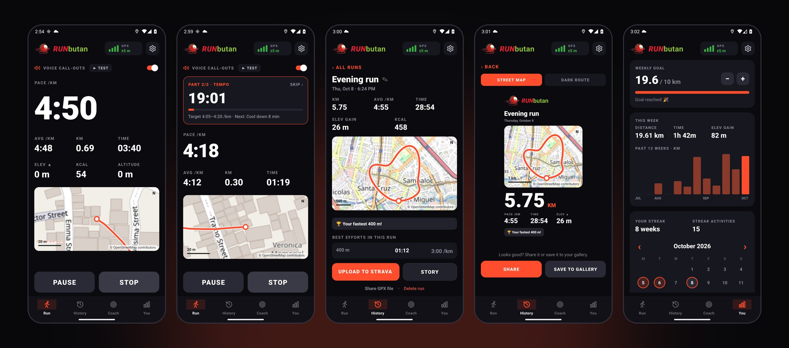
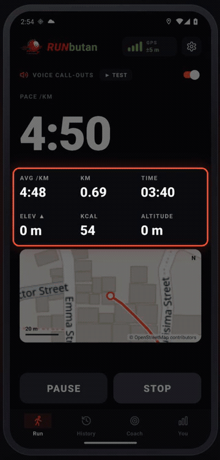
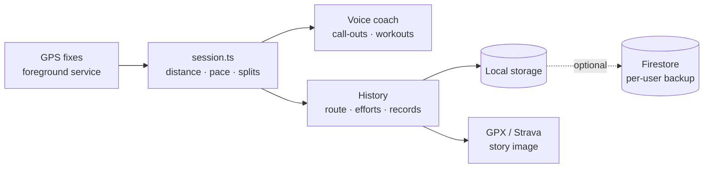

<div align="center">


# RUNbutan

**A free, offline-first running app with a voice coach.**
Track every run with GPS, hear your pace in your ear, follow adaptive training plans, and keep
your history yours.

[](https://github.com/vjdchvz/runbutan/actions/workflows/build-apk.yml)


[**Download**](#download) &nbsp;·&nbsp; [**Watch the 5-minute tour**](docs/media/runbutan-tour.mp4) &nbsp;·&nbsp; [**How it works**](#how-it-measures-a-run)

<br />



<br />

<a href="docs/media/runbutan-tour.mp4"></a>

<sub>Click the animation to watch the full narrated tour.</sub>

</div>

<br />

## Why RUNbutan

Most running apps either lock the voice coach behind a subscription or need a connection to be
useful. RUNbutan does the opposite: everything runs on the phone, with no ads, no analytics and no
account required. Sign in with Google only if you want your history backed up.

## Highlights

**Run**
- GPS tracking in a foreground service that keeps going with the screen off
- Live pace, average, distance, time, elevation and calories (from your body weight)
- Kilometre or mile splits, pause and resume, unfinished-run recovery
- Lock-screen controls: Pause and Stop (Stop needs two presses, so a pocket tap can't end a run)
- Route map that works with no signal, with OpenStreetMap tiles drawn underneath when online

**Voice coach**
- Call-outs every 15 s to 5 min: pace, average, distance, time and every split, your choice of which
- Lowers your music while it speaks and brings it back afterwards
- Guided workouts that count you in, announce each part and tell you your pace against the target

**Training**
- Plans from Couch to 5K through Marathon to Ultra, plus 5K Speed
- Adaptive coaching: the next session eases or pushes (up to 15 %) based on how recent ones went
- Quick workouts (intervals, tempo, fartlek, pyramid), warm-up, stretch and strength routines
- Pace zones and race predictions from your best effort, heart-rate zones, a cadence beat

**History and records**
- Every run with its map, splits and best efforts (400 m up to the marathon) with record badges
- Weekly goal, 12-week chart, streaks, month calendar and recap
- Shareable 9:16 story image of any run

**Strava**
- One-tap upload: saves a cleaned GPX and opens Strava's upload page
- Moving time and pace follow Strava's own rule, so the numbers line up
- Import your whole Strava history from the archive zip Strava emails you

## Download

| Platform | Get it | Notes |
|---|---|---|
| **Android** | [**runbutan-latest.apk**](https://github.com/vjdchvz/runbutan-releases/releases/download/android-latest/runbutan-latest.apk) | Open the file and allow "install unknown apps" when asked. Updates install over the previous version and keep your runs. |
| **iPhone** | [Downloads page](https://github.com/vjdchvz/runbutan-releases/releases/tag/ios-latest) | An unsigned build: sign it with your own Apple ID using [Sideloadly](https://sideloadly.io). Free Apple IDs need re-signing every 7 days. |

All builds are produced by GitHub Actions from this repository and published to
[`runbutan-releases`](https://github.com/vjdchvz/runbutan-releases).

## How it measures a run

Accuracy on a phone is mostly a matter of trusting the right signal.

- **Distance and pace** come from the phone's own GPS speed (the satellites' Doppler shift), which is
  far steadier than differences between jittery positions. Where a phone reports no speed, the
  app falls back to jitter-filtered positions.
- **Moving time** uses the same rule Strava describes: faster than about 0.9 m/s counts as
  moving, and a slower stretch only counts as rest after 15 s, so a quick stop at a crossing
  doesn't stop the clock.
- **Strava upload** smooths GPS jitter out of the exported route, because Strava adds up every hop
  between points and raw jitter makes the distance too long.
- **Every run keeps a GPS log**: each fix the phone delivered, and what the app did with it. Run
  details → *GPS log* saves it as a CSV.



## Privacy

- Your runs live on your phone. Nothing leaves it unless you sign in with Google, and then only
  to your own account's Firestore documents (rules in [`firestore.rules`](firestore.rules)).
- No ads, no analytics, no tracking SDKs.
- The only other network calls are OpenStreetMap map tiles and, when you choose it, opening
  Strava's upload page in your browser.

## Built with

Expo SDK 57 · React Native 0.86 · TypeScript (strict) · a local Kotlin native module for audio
ducking, the run notification and the cadence beat · Firebase Auth and Firestore (optional) ·
GitHub Actions for builds · [Remotion](https://remotion.dev) for the demo videos.

## Build from source

Background GPS does not work in Expo Go, so use a dev build.

```bash
npm install

# Android (JDK 17+; Android Studio's bundled JDK works)
npx expo prebuild --platform android
cd android
JAVA_HOME="/Applications/Android Studio.app/Contents/jbr/Contents/Home" \
ANDROID_HOME=~/Library/Android/sdk \
./gradlew app:assembleRelease -PreactNativeArchitectures=arm64-v8a
adb install -r app/build/outputs/apk/release/app-release.apk

# iOS (Xcode 26.4 or newer)
npx expo prebuild --platform ios && open ios/*.xcworkspace
```

On first start allow location **all the time** and **precise** (Android).

Checks and tools:

```bash
npx tsc --noEmit                                  # typecheck
npx tsx tools/replay.ts --synthetic               # replay a simulated city run through the real logic
npx tsx tools/replay.ts run-gps-log.csv           # replay a GPS log saved from the app
npx tsx tools/replay.ts --synthetic --old=<ref>   # compare against the logic at an older commit
```

## Project structure

| Path | What's in it |
|---|---|
| `App.tsx`, `src/*Screen.tsx` | App shell and screens (Run, History, Coach, You, Settings) |
| `src/session.ts` | Live run state: GPS fixes, pace, distance, splits, pause, coaching hook |
| `src/movingStats.ts`, `src/gpxClean.ts` | Strava-style moving time and splits; GPS smoothing for export |
| `src/coach/` | Workouts, plans, voice-coaching engine, VDOT pace model, adaptive coaching |
| `src/history.ts`, `src/inprogress.ts`, `src/fixlog.ts` | Storage, crash recovery, GPS log |
| `src/stravaExport.ts`, `src/importStrava.ts` | Strava archive import |
| `src/auth.ts`, `src/firebase.ts`, `src/sync.ts` | Optional Google sign-in and Firestore backup |
| `modules/runkit/` | Local Expo native module (Kotlin) |
| `tools/replay.ts` | Replays GPS logs through the real logic on a computer |
| `promo/` | Remotion project that renders an animated feature tour |
| `.github/workflows/` | Android build on every push to `main`; iOS build on demand |

## Releases and CI

Every push to `main` builds a release APK and updates the `latest` release. The iOS build is
started by hand (Actions → *Build iOS*) because macOS runner minutes are billed at ten times the
Linux rate. Builds are published to the public
[`runbutan-releases`](https://github.com/vjdchvz/runbutan-releases) repository (the workflows do this
when a `RELEASES_TOKEN` secret with write access to it is set).

<details>
<summary><strong>Cloud sync setup (maintainer notes)</strong></summary>

<br />

Google sign-in and Firestore backup (Settings → Account) need setup once, outside the repo, in
the Firebase project behind the config in `.env`. That config is not a secret: Firebase's web
config is public by design and access is controlled by Firestore Security Rules.

1. **Firestore Security Rules**: paste `firestore.rules` into Firebase Console → Firestore
   Database → Rules → Publish. Without this, Firestore's default rules either deny everything
   (sign-in works, sync silently fails) or allow anyone to read and write anyone's runs.
2. **An Android OAuth client**: Google Cloud Console → APIs & Services → Credentials → OAuth
   client ID → *Android*, for package `com.runbutan.app` and the SHA-1 of the keystore that signs
   the build (`keytool -list -v -keystore keystores/debug.keystore -storepass android -alias
   androiddebugkey`). A different keystore needs its own client registered against its SHA-1.
3. **An iOS OAuth client** for bundle id `com.runbutan.app`; set its id in
   `EXPO_PUBLIC_GOOGLE_IOS_CLIENT_ID` and its reversed form as the URL scheme in `app.json`.

`EXPO_PUBLIC_GOOGLE_WEB_CLIENT_ID` in `.env` is the ID the app reads (`src/auth.ts`). Until it is
set, Settings shows "Google Sign-In isn't set up yet" instead of a broken button.

Sign-in uses the native Play Services picker, not a browser redirect: Google blocks the
redirect flow's custom URI scheme for apps that haven't verified ownership through Play Console.

</details>

## Status and known limitations

RUNbutan is an actively developed personal project, not a store release.

- **Android is the primary platform.** The iPhone build works but is unsigned, has no lock-screen
  controls, and its cadence beat only runs while the app is on screen (iOS allows nothing else).
- **Distance can differ from Strava by a few percent** on long city runs with weak GPS. Each run
  keeps a GPS log so this can be tuned against real data.
- **Elevation gain** comes from GPS altitude, which is noisy; expect it to read high on flat runs.
- **Strava import** reads GPX and TCX files; runs stored only as `.fit` come in without a map.
- **Not on Google Play or the App Store.**

## License

Source available, **all rights reserved**: the code is public to read and the app is free to
install, but it is not open source and may not be copied or redistributed. See [LICENSE](LICENSE).

Map data © [OpenStreetMap](https://www.openstreetmap.org/copyright) contributors. "Strava" is a
trademark of Strava, Inc.; RUNbutan is not affiliated with it.
